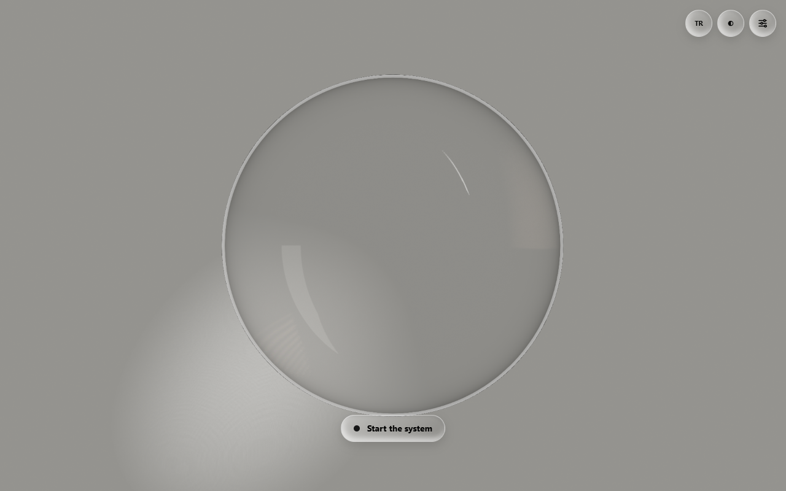
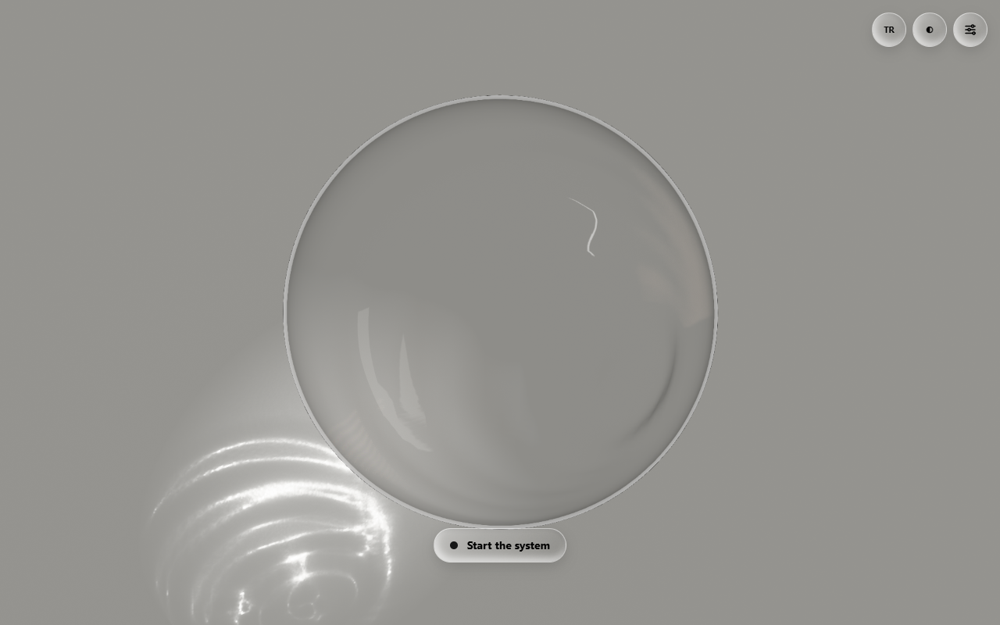
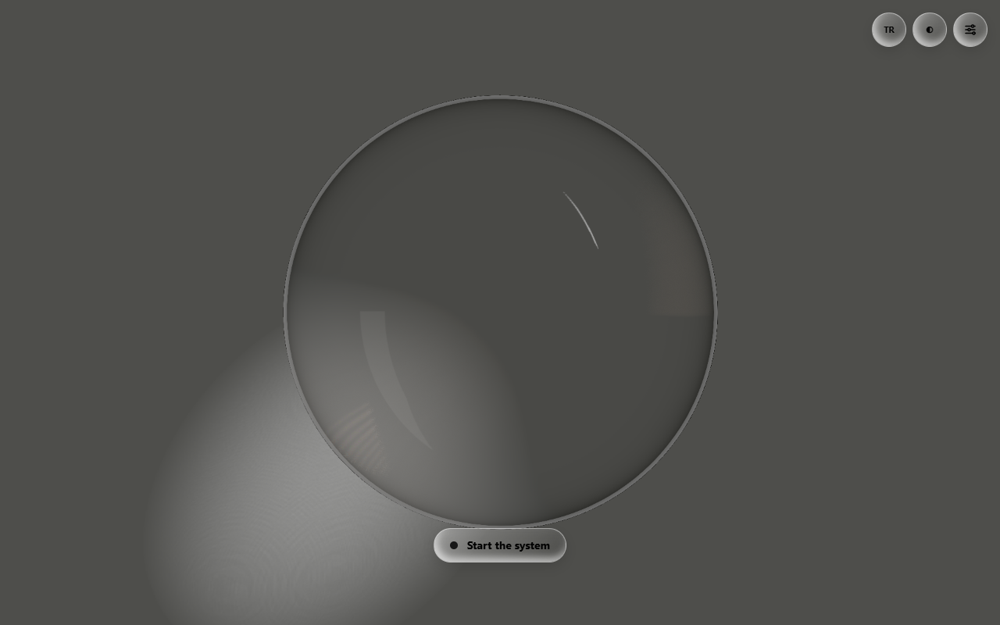
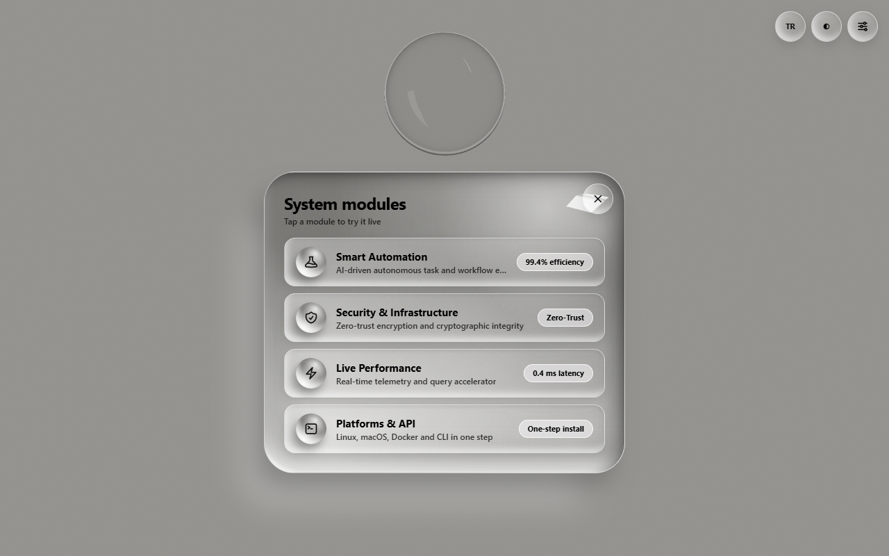
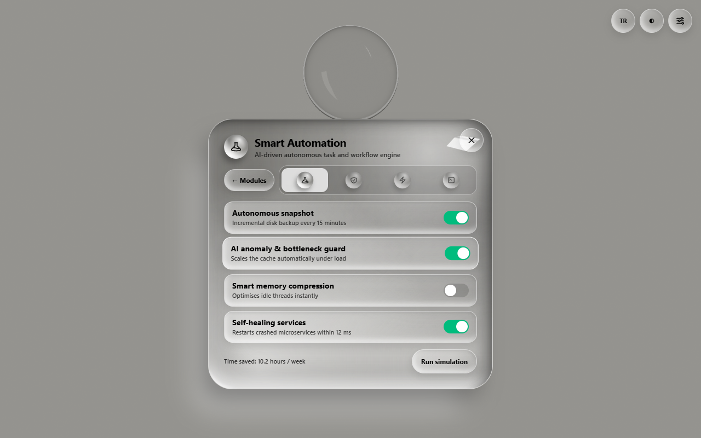
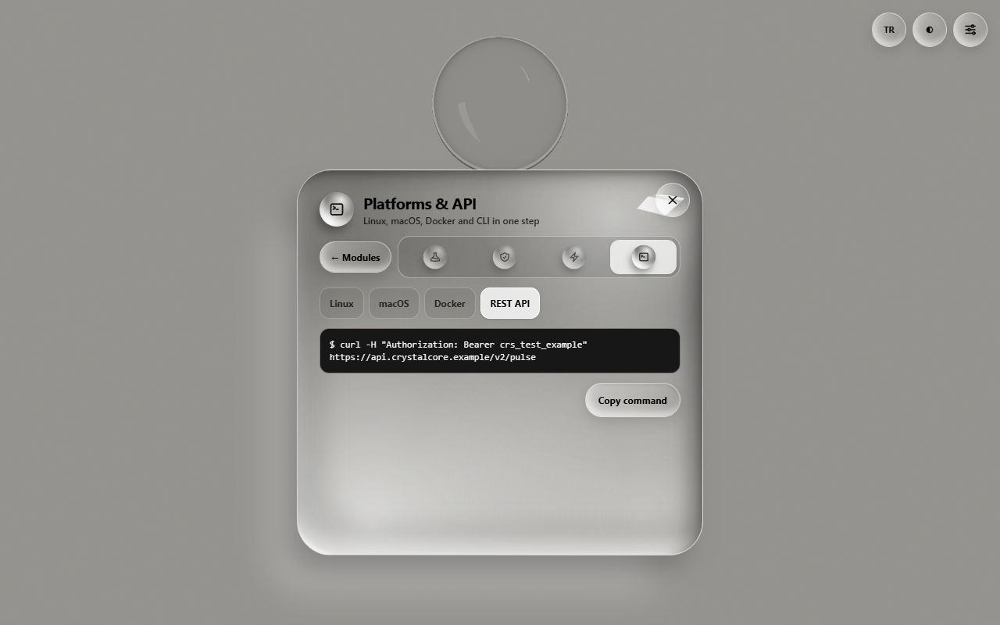
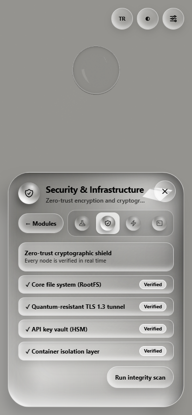

# CrystalCore — Crystal Sphere Showcase

An interactive liquid-glass crystal sphere built with React, Three.js and React Three Fiber. The sphere refracts a studio backdrop in real time, casts a caustic, ripples where you touch it, and springs open into a glass control panel with four live micro-demos for a fictional product. Turkish and English, desktop and phone.

**Live demo: https://fmcoskun.github.io/crystal-sphere-showcase/**



| Pointer ripples and the caustic they cast | Dark studio |
| --- | --- |
|  |  |
| **Module panel** | **Smart Automation** |
|  |  |
| **Platforms & API** | **On a phone** |
|  |  |

## What you can do

- **Move the pointer or drag a finger** over the stage: the sphere tilts towards the light, its surface ripples where the pointer crosses it, and the caustic on the backdrop follows. On phones that allow it, tilting the device does the same.
- **Press "Start the system"**: the sphere shrinks and parks at the top while a glass panel springs open with four modules.
- **Open a module** to try its micro-demo. Smart Automation toggles rules and adds up the hours saved, Security & Infrastructure runs an integrity scan, Live Performance switches between turbo and balanced modes, and Platforms & API shows and copies install commands. The icon tabs switch between modules without leaving the panel.
- **Corner controls**: switch language (TR/EN) and theme (light/dark studio), or open the studio sliders for light angle, caustic strength and window glare.

Everything in the demos is made up; commands point at the reserved `.example` domain.

## How it works

**One state machine drives the page.** `stageReducer` (`src/state/stage.ts`) moves between three views: the sphere on its own, the module list, and a module's detail. The sphere and the panel are independent components that both read that state. Input arriving while the opening spring runs (650 ms) is ignored, so rapid taps can't tangle the transition.

**The sphere** (`src/scene/CrystalSphere.tsx`) is a mesh with drei's `MeshTransmissionMaterial`. It renders the scene behind it into a buffer and refracts it with an index of 1.52, chromatic aberration and a thin backside, which gives the glass look. The lighting is a hand-built studio of `Lightformer` softboxes (`Lights.tsx`) rather than an HDRI, with a sharp window light top-right that gives the sphere its signature highlight.

**The liquid surface** (`src/scene/liquid.ts`) is computed on the CPU every frame. Each vertex is pushed along its own direction by a slow "breathing" noise plus up to four expanding ripples. A ripple starts where the pointer ray meets the sphere, an analytic ray–sphere hit rather than a mesh raycast. The sphere's seam is welded so the per-frame normals stay smooth. Reduced-motion users get a still sphere.

**The caustic** comes in two kinds. On capable devices drei's `Caustics` (`CausticsLayer.tsx`) traces the sphere's refraction from a light placed by the angle slider. Its projection plane is turned to become the backdrop and placed at the ball lens's focal distance (f = nR / 2(n − 1) ≈ 2.2), where the light gathers into a bright spot. Lighter devices get a painted caustic texture (`CausticFloor.tsx`). Either one lives inside the sphere's group, so it shrinks and moves with the sphere when the panel opens.

**Postprocessing** (`Effects.tsx`) adds bloom on the highlights, SMAA, a little film grain and Khronos PBR Neutral tone mapping. Tone mapping would also shift the flat studio grey, so `toneMap.ts` runs the background colour through the inverse of the Neutral curve: the grey comes out exactly `#94938f` (light) or `#4e4e4b` (dark).

**Quality adapts to the device** (`src/scene/quality.ts`). Phones start at tier 2 and desktops at tier 3. A frame meter averages frame times and steps the tier down when frames run slow: lower pixel ratio, fewer refraction samples, then no real caustics or liquid surface, and finally no postprocessing. Devices without WebGL, or very weak ones, get a pure-CSS sphere instead (`src/fallback/`). The same CSS sphere shows while the WebGL code loads, and it takes over if the GPU context is lost.

**The panel** (`src/panel/`) is real, accessible HTML with CSS glass, not part of the 3D scene. The four demos are stacked in one grid cell so the panel keeps the height of the tallest one across tabs. Hidden demos are `inert`, `aria-hidden` and transparent, so they can't be focused or read and don't show through.

**Loading** (`vite.config.ts`): the first paint needs only the app and React (about 125 kB gzip). three.js, React Three Fiber, drei and postprocessing load lazily in separate, long-cacheable chunks.

## Run

```bash
npm install
npm run dev        # http://localhost:5173
npm test           # vitest
npm run build      # typecheck + production build into dist/ + bundle budget
npm run visual     # visual checks against a running server (see below)
```

Requires Node 20.11+ (jsdom is pinned to 26 and Vite to 6 for that floor).

Dev-only flags: `?renderer=css` or `?renderer=webgl` forces a sphere renderer; `?tier=0`–`3` sets the starting quality tier (the frame meter can still lower it).

### Visual checks

`scripts/visual-check.mjs` drives a local Chrome over the DevTools protocol (no dependencies; Node 22+, `CHROME_PATH` overrides the lookup):

```bash
npm run dev   # or: npm run build && npm run preview  (then --url http://localhost:4173)
npm run visual -- --check all --size 1280x800,390x844          # panel size + studio background
npm run visual -- --query "renderer=webgl&tier=1" --check bg --theme dark
npm run visual -- --open --shot shots/                        # screenshots, panel open
```

- `panel`: the dialog keeps one width and height across the four module tabs, the previous demo is gone 60 ms after a switch, and nothing scrolls sideways on any Platforms sub-tab.
- `bg`: the studio grey in two corners is the theme colour within ±3 per channel, whatever the tier. With `--open`, also left of the panel, where a caustic left behind by the parked sphere would show.
- `tone`: the inside of the sphere matches between tier 0 (no postprocessing) and tier 1 within ±3. Needs the dev server, since `?tier=` is dev-only.

## How it fits together

| Area | Files |
| --- | --- |
| Stage state machine (orb → list → detail) | `src/state/stage.ts`, `src/Stage.tsx` |
| WebGL sphere, lights, caustic floor | `src/scene/CrystalScene.tsx`, `CrystalSphere.tsx`, `Lights.tsx`, `CausticFloor.tsx` |
| Real caustics (tiers 2–3), liquid surface and pointer ripples | `src/scene/CausticsLayer.tsx`, `src/scene/liquid.ts` |
| Postprocessing and the tone-mapped studio background | `src/scene/Effects.tsx`, `src/scene/toneMap.ts` |
| Renderer choice, quality tiers, context-loss fallback | `src/scene/SphereHost.tsx`, `src/scene/quality.ts` |
| Pure CSS fallback sphere (no WebGL or very weak devices) | `src/fallback/` |
| Pointer / touch / tilt light mapping | `src/scene/input.ts`, `useLightOffset.ts` |
| Glass panel, module list, micro-demos | `src/panel/` |
| Language, theme, studio sliders | `src/i18n/`, `src/ui/` |

## Build output (2026-10-30, gzip by `scripts/check-bundle.mjs`)

| Chunk | gzip | Loaded |
| --- | --- | --- |
| `index.js` (app, Motion) | 56.4 kB | first paint |
| `vendor.js` (React, Vite helpers) | 68.1 kB | first paint |
| `three.js` | 188.4 kB | lazy |
| `r3f.js` (r3f, drei, three-stdlib) | 89.8 kB | lazy |
| `post.js` (postprocessing) | 79.6 kB | lazy |
| `CrystalScene.js` | 3.1 kB | lazy |

Budget: first paint ≤ 135 kB, WebGL stack ≤ 380 kB; `npm run build` fails above either. Only `vendor.js` is preloaded; the CSS sphere shows while the WebGL chunks load.

### Quality tiers

| Tier | DPR | Post | Caustics | Liquid surface |
| --- | --- | --- | --- | --- |
| 0 | 1 | off | fake | off |
| 1 | 1.25 | tone map + SMAA | fake | off |
| 2 | 1.5 | + bloom + grain | real, 512 | on |
| 3 | 2 | + bloom + grain | real, 1024 | on |

Phones start at tier 2, desktops at 3; slow frames step the tier down. Reduced motion turns the liquid surface off at every tier.

## Verification status

- Unit tests: 82 passing (logic, state, i18n, panel flow, focus, fallbacks, frame sampling, tone-map compensation, liquid surface, caustic geometry).
- Visual checks (headless Chrome, production build, 1280×800 and 390×844): panel size fixed across tabs; studio background exact in light and dark at tiers 0, 1 and 3.
- Checked in a desktop browser (800×600) and a 375×812 mobile emulation: sphere, caustic, panel spring, four demos, dark theme, studio sliders.
- Real phone check (2026-10-30, over the LAN): sphere fit, touch drag, smoothness, panel, four demos and corner controls all worked; repeated on the production build after the liquid surface, caustics and postprocessing landed.
- **Not yet checked:** iOS tilt. Motion sensors need HTTPS: the LAN test was plain http, but the GitHub Pages site is served over HTTPS.
- **Deployed** to GitHub Pages by `.github/workflows/pages.yml` on every push to `master`: tests, typecheck, build and bundle budget must pass first. Asset paths are relative (`base: './'`), so the same build works from the Pages subpath and from `vite preview`.
